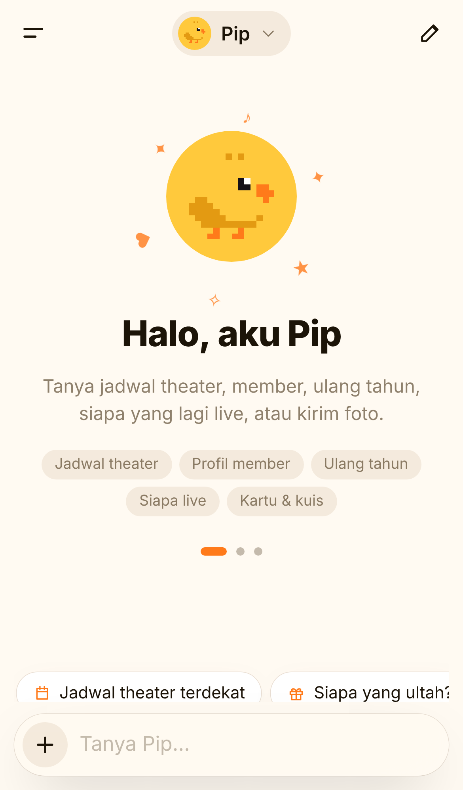
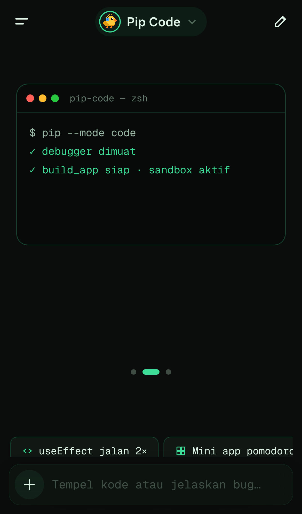
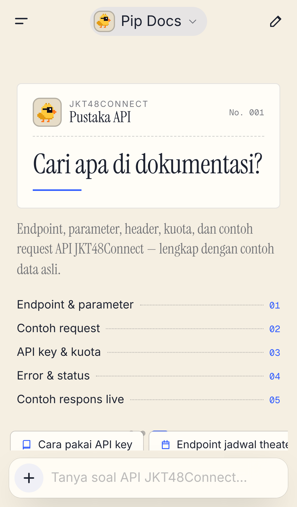

# Pip-AI

A landing page and chat app for **Pip**, the assistant from the JKT48Connect Pip AI API. Pip can **read attachments**: photos, screenshots, PDFs, Word and Excel files, CSVs, and text or code files.

- **React 18 + TypeScript**, built with Vite
- **GSAP only** for motion: ScrollSmoother, ScrollTrigger, SplitText, Flip, CustomEase, `@gsap/react`
- **Cloudflare Workers**: static assets plus a small API Worker. The API key never reaches the browser.

  

## Pages

**`/`, the landing page**: dark, solid colours (no gradients), driven by live data from `GET /api/jkt48/home`.

| Section | Motion |
| --- | --- |
| Header | Floating pill. An indicator glides under the hovered link and follows the section on screen; the pill tightens after the hero and tucks away while scrolling down fast. On phones, a full-screen menu unfolds with the next show and birthday. |
| Hero | The title rises letter by letter. A deck of real member photos keeps shuffling (tap one to ask Pip about her). Blocks drop into steps and Pip lands on top. Live pills show the next show, next birthday and who is live. Pointer parallax, then a scrubbed exit. |
| Bands | Two crossing marquee bands whose speed and direction follow scroll velocity. |
| Statement | Words light up as you scroll; member photos pop in between them. |
| Hari ini | Pinned horizontal rail of real schedule, birthday and news cards with a live countdown, image parallax and tilt. |
| Modes | Pip, Pip Code and Pip Docs as sticky cards that stack and recede, each in its own theme with a small demo. |
| Lampiran | Pinned product mock playing a chat turn with an attachment. |
| Member | Columns of member photos drifting in opposite directions behind a panel. |
| Footer | Giant link with rolling letters, live tiles (next show countdown, next birthday, Jakarta clock), link columns, a ground of blocks Pip walks along, a `PIP` pixel wordmark that reacts to the cursor, and back-to-top with a scroll progress ring. |

**`/chat`, the chat app**: an iPhone-style AI chat with a floating composer, a history drawer (swipe from the left edge) and three modes, each with its own expertise, theme and motion — **Pip** (JKT48 & everyday), **Pip Code** (engineering, mini apps) and **Pip Docs** (JKT48Connect API reference). Switching modes plays a circular theme wipe.

Pip can call tools in an agent loop run by the Worker: JKT48 schedule, show details, members & profiles, birthdays, news, who is live, live recaps and setlists (from api.jkt48connect.app), plus weather and a calculator. Results render as interactive cards. `show_ui` lets Pip assemble native UI (charts, quizzes, polls, checklists, countdowns, tables, timelines, buttons) and `build_app` lets it write a mini app that runs in a sandboxed iframe with no network access.

- **Attaching files.** Use the paperclip, drag and drop anywhere, or paste images. You can add up to 6 files, each up to 10 MB. Each attachment chip shows its reading status.
- **Composer.** It starts centred and glides to the bottom (GSAP Flip) once the conversation begins. It holds the profile picker and a stop button.
- **Replies** stream in as Markdown, with syntax-highlighted code, tables and copy buttons, plus actions to copy or regenerate.

## How Pip reads files

The Pip API only accepts text, so the Worker converts each attachment to text and sends it to Pip as context.

| File | Handled by |
| --- | --- |
| Text and code (`.txt .md .csv .json .js .py …`) | Read in the browser |
| Images (any format the browser can open) | Downscaled to ≤1600px JPEG in the browser, then `/api/read` → Workers AI vision model (`@cf/meta/llama-4-scout-17b-16e-instruct`) describes the image and transcribes its text |
| PDF, DOCX, XLSX, ODS, ODT, Numbers | `/api/read` → Workers AI `toMarkdown` |

## Develop

```bash
npm install
cp .dev.vars.example .dev.vars        # put your jkc_… developer key in PIP_API_KEY
npm run dev                           # chat works; image/document reading needs Workers AI ↓
npx wrangler login && PIP_REMOTE=1 npm run dev   # also read images/documents locally
```

## Deploy to Cloudflare

```bash
npx wrangler login
npx wrangler secret put PIP_API_KEY   # stored encrypted on Cloudflare
npm run deploy
```

Workers AI comes with the `AI` binding in `wrangler.jsonc`. The free plan includes a daily allowance.

## API (Worker)

| Route | Description |
| --- | --- |
| `POST /api/chat` | `{ model, messages }` → `text/plain` stream from the Pip API |
| `POST /api/read` | `multipart/form-data` with `file` → `{ name, kind, text, via }` |
| `GET /api/health` | `{ ok, chat, read }` |

Both POST routes reject requests from other origins. Upstream errors are mapped to friendly Indonesian messages.

## Structure

```
worker/index.ts        API Worker (chat proxy + attachment reading)
src/site/*             Landing page sections
src/chat/*             Chat app, composer, attachment handling (files.ts)
src/components/*       Sprite, Pixels (DOM pixel grids for animated icons/blocks)
src/lib/*              gsap setup, router, markdown renderer, chat streaming, storage
previews/              Desktop & mobile screenshots
```
