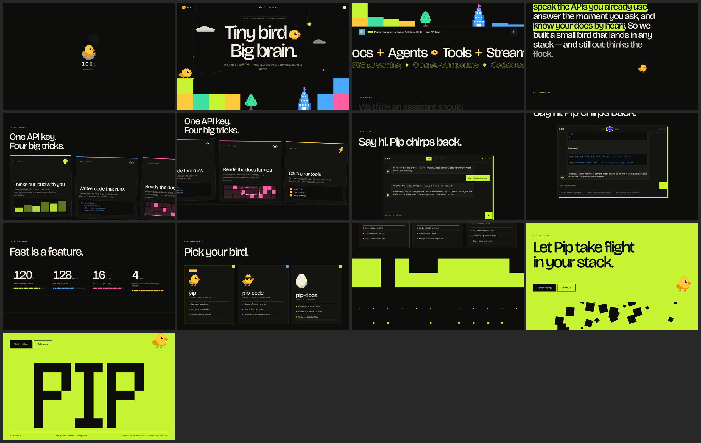

# Pip-AI

A landing page and live chat for **Pip**, the assistant from the JKT48Connect Pip AI API. Pip is drawn as a tiny pixel bird with a big brain.

- **React 18 + TypeScript**, built with Vite
- **GSAP only** for motion: ScrollSmoother (smooth scroll), ScrollTrigger, SplitText, CustomEase, `@gsap/react`
- **Cloudflare Workers**: static assets plus a Worker at `/api/chat` that forwards chat requests to the Pip API. The API key never reaches the browser.



## What's on the page

| Section | Motion |
| --- | --- |
| Preloader | An egg wobbles while a counter runs from 0 to 100%, then cracks and Pip hatches. Pixel columns slide away to reveal the hero. |
| Hero | Characters drop in with a mask. Blocks fall with a bounce, Pip lands with a squash and stretch, blinks, hops, and turns to face the cursor. Clicking Pip makes it jump and release pixel hearts. On scroll the scene breaks up with parallax. |
| Marquee | Two rows that loop forever. Speed, direction and skew follow your scroll velocity. |
| Manifesto | Words light up one by one as you scroll, with highlights that draw in. |
| Capabilities | A pinned section that scrolls sideways. Each card plays its own small animation: bars, code typing, a scan, a tool-call list. |
| Try Pip | A live chat that streams from the API. It types a first prompt by itself when you scroll to it. Three profiles: `pip`, `pip-code`, `pip-docs`. |
| Numbers / Profiles | Counters, stepped pixel bars, 3D tilt cards with a corner that floods with color. |
| Pixel wipe → CTA → Footer | The dark page dissolves into lime pixel by pixel. Buttons pull toward the cursor, and the `PIP` wordmark assembles from scattered pixels. |

It also has a custom pixel cursor, a menu that unfolds in columns, and a header that hides as you scroll down. The layout is responsive, and `prefers-reduced-motion` is respected.

## Develop

```bash
npm install
cp .dev.vars.example .dev.vars   # put your jkc_… developer key in PIP_API_KEY
npm run dev                      # Vite + local Workers runtime (workerd)
```

If no key is set, the chat falls back to a small set of offline replies, so the page still works.

## Deploy to Cloudflare

```bash
npx wrangler login
npx wrangler secret put PIP_API_KEY   # paste the key; it is stored encrypted on Cloudflare
npm run deploy                        # tsc + vite build + wrangler deploy
```

Config is in `wrangler.jsonc`. `PIP_API_BASE` defaults to `https://api.jkt48connect.app/v1`.

## API (Worker)

| Route | Description |
| --- | --- |
| `POST /api/chat` | `{ model: "pip" \| "pip-code" \| "pip-docs", messages: [{ role, content }] }`. Returns a `text/plain` stream. Requests from other origins are rejected. |
| `GET /api/health` | `{ ok, configured }` |

Upstream status codes from the gateway (429, 413, 502, …) are mapped to friendly messages. The site's 401 is never passed on to visitors.

## Structure

```
worker/index.ts          Cloudflare Worker (API proxy → JKT48Connect Pip API)
src/App.tsx              ScrollSmoother + shared heading reveals
src/components/*         Preloader, Nav, Hero, Marquee, Manifesto, Features, Demo, Sections, Cursor, Sprite
src/lib/gsap.ts          Plugin registration + house eases (pip.out / pip.inOut / pip.pop)
src/lib/sprites.ts       Hand-drawn pixel sprites (rendered as crisp SVG)
src/lib/chat.ts          Streaming client + offline fallback
previews/                Desktop & mobile screenshots
```
