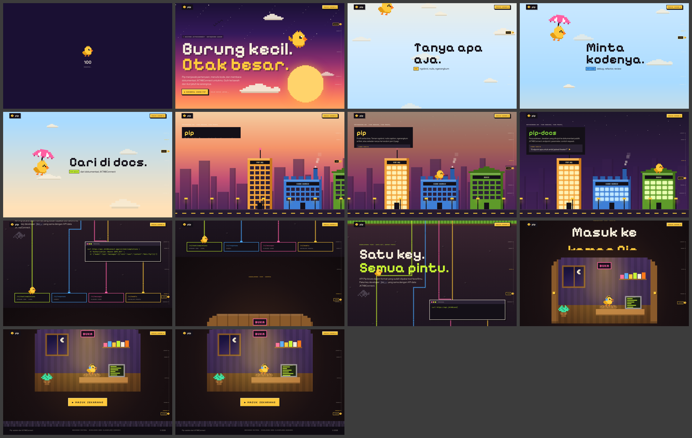
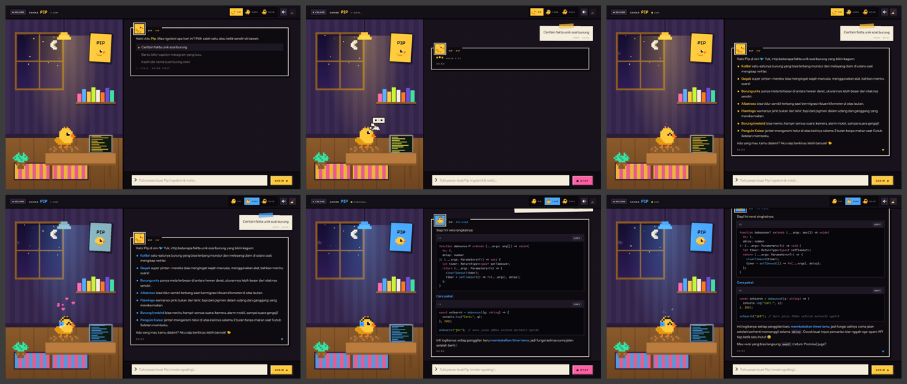

# Pip-AI

A landing page and live chat for **Pip**, the assistant from the JKT48Connect Pip AI API. Pip is drawn as a tiny pixel bird with a big brain.

- **React 18 + TypeScript**, built with Vite
- **GSAP only** for motion: ScrollSmoother, ScrollTrigger, MotionPath, SplitText, CustomEase, `@gsap/react`
- **Cloudflare Workers**: static assets plus a Worker at `/api/chat` that forwards chat requests to the Pip API. The API key never reaches the browser.




## The landing page: a fall into Pip's nest

You scroll *down through a world* instead of past stacked sections. An altimeter on the right edge tracks your height.

| Stop | What happens |
| --- | --- |
| **Sky** (1200m) | A dawn sky with a pixel sun. The title drops in with stepped (8-bit) motion, and each letter jumps on hover. Pip flaps, drifts toward your pointer, and does a loop when clicked. A flock crosses the sky. |
| **Clouds** (pinned) | Pip opens an umbrella and drifts down while clouds rush past. One line per profile (`pip`, `pip-code`, `pip-docs`) twinkles in pixel by pixel. |
| **City** (pinned) | A dusk street with three buildings, one per profile. Scrolling makes Pip hop from roof to roof and turns night on. Windows light up and a billboard explains each profile, with a prompt that opens the room with that question. On narrow screens the camera pans. |
| **Underground** | Circuit cables are drawn to the real positions of the four API endpoints. Data packets flow along them, Pip rides a cable down as you scroll, and a `curl` command types itself. |
| **Nest** | A wooden door slides open to reveal Pip's lit room, then a big button takes you inside. |

## The room (`/room`): the chat

- **Pip's pixel room.** The window follows your real clock (day, dusk, night); click it to cycle. The lamp, poster and rug take the colour of the current profile.
- **Pip reacts.** Pip leans in while you type, shows a thought bubble while thinking, flaps its beak while a reply streams, smiles with hearts or notes when done, sees stars on an error, and falls asleep (zzz) if you go quiet. Click Pip to pet it.
- **Profiles as accessories.** `pip` has no accessory, `code` adds headphones, `docs` adds reading glasses. Switching gives a puff of smoke.
- **Replies arrive in RPG dialog boxes** with Pip's portrait and a ▼ marker. Markdown is rendered safely, with syntax-highlighted code blocks and copy buttons.
- **Your messages are taped paper notes.** Sending one flies a paper plane to Pip.
- **The first message offers RPG-style choices**: navigate with ↑ ↓ and send with Enter.
- **Other controls:** stop a reply mid-stream, retry after an error, sweep the chat away with a broom, and turn on optional 8-bit voice blips (WebAudio, off by default).
- The conversation is saved in the browser (localStorage).

## Develop

```bash
npm install
cp .dev.vars.example .dev.vars   # put your jkc_… developer key in PIP_API_KEY
npm run dev                      # Vite + local Workers runtime (workerd)
```

If no key is set, the chat falls back to a small set of offline replies, so the page still works.

## Deploy to Cloudflare

```bash
npx wrangler login
npx wrangler secret put PIP_API_KEY   # paste the key; it is stored encrypted on Cloudflare
npm run deploy                        # tsc + vite build + wrangler deploy
```

Config is in `wrangler.jsonc`. `PIP_API_BASE` defaults to `https://api.jkt48connect.app/v1`.

## API (Worker)

| Route | Description |
| --- | --- |
| `POST /api/chat` | `{ model: "pip" \| "pip-code" \| "pip-docs", messages: [{ role, content }] }`. Returns a `text/plain` stream. Requests from other origins are rejected. |
| `GET /api/health` | `{ ok, configured }` |

Upstream status codes from the gateway (429, 413, 502, …) are mapped to friendly messages. The site's 401 is never passed on to visitors.

## Structure

```
worker/index.ts          Cloudflare Worker (API proxy → JKT48Connect Pip API)
src/App.tsx              tiny router: "/" → landing, "/room" → chat
src/landing/*            Sky, Fall, City, Under, Nest, top bar + altimeter
src/room/*               Room (chat logic) + RoomScene (Pip's room)
src/components/*         Sprite, PipAvatar (expressions/accessories), Preloader, PixelTransition
src/lib/gsap.ts          Plugin registration + house eases (pip.out / pip.inOut / pip.pop)
src/lib/sprites.ts       Hand-drawn pixel sprites (rendered as crisp SVG)
src/lib/chat.ts          Streaming client + offline fallback
src/lib/markdown.tsx     Safe Markdown renderer + tiny syntax highlighter
src/lib/sound.ts         8-bit blips (WebAudio)
previews/                Desktop & mobile screenshots
```
