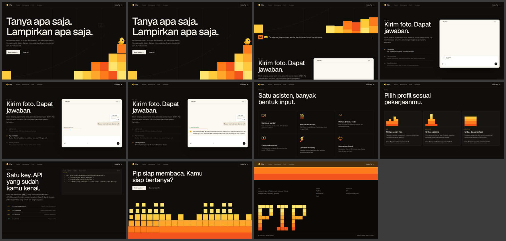
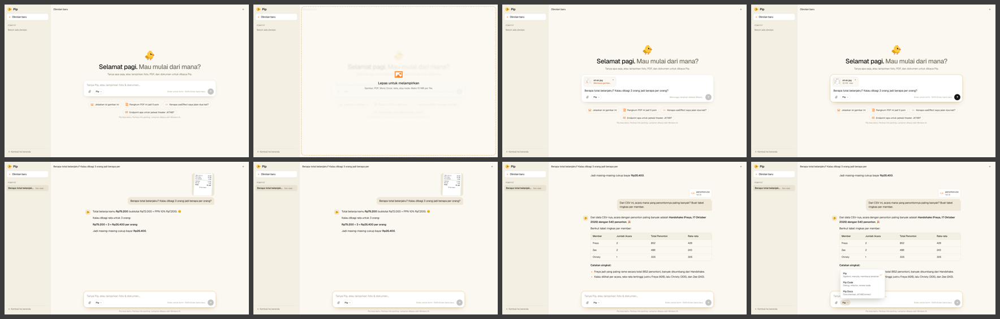

# Pip-AI

A landing page and chat app for **Pip**, the assistant from the JKT48Connect Pip AI API. Pip can **read attachments**: photos, screenshots, PDFs, Word and Excel files, CSVs, and text or code files.

- **React 18 + TypeScript**, built with Vite
- **GSAP only** for motion: ScrollSmoother, ScrollTrigger, SplitText, Flip, CustomEase, `@gsap/react`
- **Cloudflare Workers**: static assets plus a small API Worker. The API key never reaches the browser.




## Pages

**`/`, the landing page**: dark, calm, and grid-lined, with pixel accents limited to flat gradient blocks and a small Pip sprite.

| Section | Motion |
| --- | --- |
| Hero | Grid lines draw in and the title rises line by line. Gradient blocks drop and stack into steps, Pip lands on top, and files keep dropping into Pip. |
| Pip Chat (pinned) | Scrolling plays one full chat turn in a product mock: a receipt is attached, the question types itself, Pip reads the file, and the answer streams in. |
| Capabilities | A bordered grid where the pixel icons assemble pixel by pixel and ripple on hover. |
| Profiles | Block towers drop in for `pip`, `pip-code` and `pip-docs`. Each card has a "try" prompt that opens the chat. |
| Developer | Tabs for curl, Python, Codex and Claude Code, with animated line swaps and a copy button. |
| CTA + footer | A gradient block skyline fills up as you scroll, and a pixel `PIP` wordmark assembles. |

**`/chat`, the chat app**: a light layout with conversation history in the sidebar (saved in the browser).

- **Attaching files.** Use the paperclip, drag and drop anywhere, or paste images. You can add up to 6 files, each up to 10 MB. Each attachment chip shows its reading status.
- **Composer.** It starts centred and glides to the bottom (GSAP Flip) once the conversation begins. It holds the profile picker and a stop button.
- **Replies** stream in as Markdown, with syntax-highlighted code, tables and copy buttons, plus actions to copy or regenerate.

## How Pip reads files

The Pip API only accepts text, so the Worker converts each attachment to text and sends it to Pip as context.

| File | Handled by |
| --- | --- |
| Text and code (`.txt .md .csv .json .js .py …`) | Read in the browser |
| Images (any format the browser can open) | Downscaled to ≤1600px JPEG in the browser, then `/api/read` → Workers AI vision model (`@cf/meta/llama-4-scout-17b-16e-instruct`) describes the image and transcribes its text |
| PDF, DOCX, XLSX, ODS, ODT, Numbers | `/api/read` → Workers AI `toMarkdown` |

## Develop

```bash
npm install
cp .dev.vars.example .dev.vars        # put your jkc_… developer key in PIP_API_KEY
npm run dev                           # chat works; image/document reading needs Workers AI ↓
npx wrangler login && PIP_REMOTE=1 npm run dev   # also read images/documents locally
```

## Deploy to Cloudflare

```bash
npx wrangler login
npx wrangler secret put PIP_API_KEY   # stored encrypted on Cloudflare
npm run deploy
```

Workers AI comes with the `AI` binding in `wrangler.jsonc`. The free plan includes a daily allowance.

## API (Worker)

| Route | Description |
| --- | --- |
| `POST /api/chat` | `{ model, messages }` → `text/plain` stream from the Pip API |
| `POST /api/read` | `multipart/form-data` with `file` → `{ name, kind, text, via }` |
| `GET /api/health` | `{ ok, chat, read }` |

Both POST routes reject requests from other origins. Upstream errors are mapped to friendly Indonesian messages.

## Structure

```
worker/index.ts        API Worker (chat proxy + attachment reading)
src/site/*             Landing page sections
src/chat/*             Chat app, composer, attachment handling (files.ts)
src/components/*       Sprite, Pixels (DOM pixel grids for animated icons/blocks)
src/lib/*              gsap setup, router, markdown renderer, chat streaming, storage
previews/              Desktop & mobile screenshots
```
